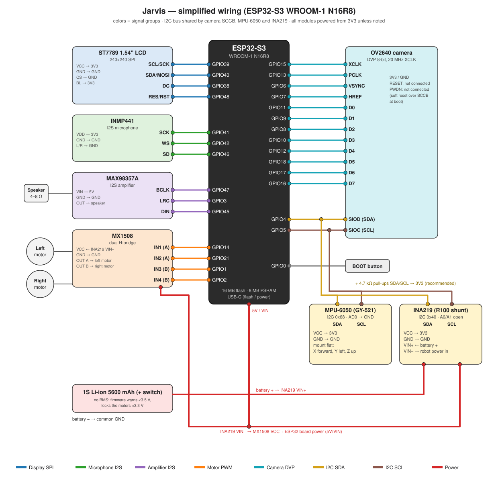

# Jarvis — ESP32-S3 Voice-Controlled Tracked Robot

Jarvis is a small tracked robot built on an **ESP32-S3 N16R8** (16 MB flash, 8 MB octal PSRAM).
You talk to it ("Jarvis, turn left 90 degrees", "go 10 cm forward", "look around", "how is your
battery?") and an LLM drives it through MCP tools running on the robot.



The firmware is a fork of the open-source
[xiaozhi-esp32](https://github.com/78/xiaozhi-esp32) voice assistant (MIT). Everything specific
to Jarvis lives in [`main/boards/robot-n16r8/`](main/boards/robot-n16r8/). The original
xiaozhi README is kept as [README_xiaozhi.md](README_xiaozhi.md).

## Features

- **Voice:** "Jarvis" wake word (on-device WakeNet), conversation through the xiaozhi server.
- **Face:** animated eyes and mouth on a 240×240 ST7789 (blink, glances, emotions, speaking
  mouth, thinking face (green eyes, still line mouth; the mouth moves only while audio plays)), Wi-Fi and battery icons, captions, camera preview, boot splash.
- **Motion:** two-track drive (MX1508). Turns are **closed-loop on the gyro**: turn until the
  measured angle is reached, brake, measure where it really stopped, correct. The stop lead is
  learned from each turn. Straight moves by time or by **distance** (timed at a fixed, calibrated speed; no distance or time given = 10 cm).
  Commands from the AI are queued and run in order; "stop" interrupts.
- **Body awareness:** detects being lifted, tipped over, bumped, and put down; stops the
  motors, shows a surprised face and reports the event to the AI.
- **Battery:** INA219 voltage/current/power; state of charge by coulomb counting (blended with
  the resting-voltage curve, persisted in NVS); eye color follows the level; motor lock below
  3.3 V (1S Li-ion without BMS).
- **Camera:** OV2640 on DVP, photo + AI description ("what do you see?").
- **Wi-Fi console** (TCP port 23): live log, motor tests, automatic calibration, IMU tools.
- **OTA over Wi-Fi** from the Mac with one script.

## Hardware

| Part | Notes |
| --- | --- |
| ESP32-S3 WROOM-1 **N16R8** dev board | 16 MB flash, 8 MB OPI PSRAM, native USB |
| ST7789 1.54" **240×240** SPI LCD | RST wired to a GPIO (software reset was not reliable) |
| OV2640 camera, DVP 8-bit | RESET/PWDN not wired (firmware resets it over SCCB) |
| INMP441 I2S microphone | L/R to GND (left channel) |
| MAX98357A I2S amplifier + speaker | |
| MX1508 dual H-bridge | two DC gear motors, tracks |
| MPU-6050 IMU (GY-521) | I2C 0x68, mounted flat: **X forward, Y left, Z up** |
| INA219 module (R100 shunt) | I2C 0x40, in series with the battery + |
| 1S Li-ion 5600 mAh | **no BMS** → firmware protection, see Battery |
| 2× **4.7 kΩ** pull-ups SDA/SCL → 3V3 | recommended, see Tips |

## Pin plan

The [wiring diagram](docs/jarvis/wiring.svg) above shows the same connections. All pins are defined in [`main/boards/robot-n16r8/config.h`](main/boards/robot-n16r8/config.h).

### Display — ST7789 240×240 (SPI2)

| Signal | GPIO |
| --- | --- |
| SCK | 39 |
| MOSI (SDA) | 40 |
| DC | 38 |
| RST | 48 |
| CS | GND (tied low) |
| BL | 3V3 (always on) |

SPI mode 3, 20 MHz, color inversion on, no gap/offset.

### Audio

| INMP441 mic | GPIO | | MAX98357A amp | GPIO |
| --- | --- | --- | --- | --- |
| SCK | 41 | | BCLK | 47 |
| WS | 42 | | LRC | 3 |
| SD | 46 | | DIN | 45 |
| L/R | GND | | | |

Mic 16 kHz, speaker 24 kHz.

### Motors — MX1508

| Signal | GPIO |
| --- | --- |
| Left IN1 | 14 |
| Left IN2 | 21 |
| Right IN1 | 1 |
| Right IN2 | 2 |

LEDC PWM on all four inputs (both high = brake).

### Camera — OV2640 (DVP)

| Signal | GPIO | Signal | GPIO |
| --- | --- | --- | --- |
| XCLK (20 MHz) | 15 | D7 | 16 |
| PCLK | 13 | D6 | 17 |
| VSYNC | 6 | D5 | 18 |
| HREF | 7 | D4 | 12 |
| SIOD (SDA) | 4 | D3 | 10 |
| SIOC (SCL) | 5 | D2 | 8 |
| PWDN | NC | D1 | 9 |
| RESET | NC | D0 | 11 |

### Shared I2C bus — GPIO4 (SDA) / GPIO5 (SCL), port 1, 100 kHz

| Device | Address | Wiring |
| --- | --- | --- |
| OV2640 SCCB | 0x30 | camera connector |
| INA219 | 0x40 | VCC 3V3, A0/A1 open; **VIN+ ← battery +, VIN− → robot power input** |
| MPU-6050 | 0x68 | VCC 3V3, AD0 GND, flat, X axis pointing forward |

The bus is created once by the board and handed to the camera driver (`init_sccb = false`).

### Other

| Function | GPIO |
| --- | --- |
| BOOT button (chat / Wi-Fi setup) | 0 |

## Build and flash

Requirements: **ESP-IDF v5.5.2** (tested), macOS or Linux.

```bash
git clone <this repo> jarvis && cd jarvis
. $HOME/esp/esp-idf/export.sh
cp sdkconfig.jarvis sdkconfig        # exact configuration used on the robot
idf.py set-target esp32s3            # only if the target is not set yet (keeps sdkconfig)
idf.py build
idf.py -p /dev/cu.usbmodemXXXX flash # first flash over USB
```

`sdkconfig.jarvis` selects `CONFIG_BOARD_TYPE_ROBOT_N16R8`, 16 MB flash with
`partitions/v2/16m.csv` (two OTA slots + 8 MB assets), octal PSRAM, the **Jarvis** wake word
(`CONFIG_SR_WN_WN9_JARVIS_TTS`), OV2640, and the LVGL Montserrat 20/48 fonts used by the
splash. The same settings are listed in
[`main/boards/robot-n16r8/config.json`](main/boards/robot-n16r8/config.json) for
`scripts/release.py`. If you build from a fresh `sdkconfig`, select the board in
`idf.py menuconfig` → *Xiaozhi Assistant → Board Type → Robot N16R8* and apply the options
from `config.json`.

On first boot the robot opens the Wi-Fi setup hotspot (`Robot-XXXX`); connect and enter your
Wi-Fi. Then it activates with the xiaozhi server (code shown on screen).

**Keep the robot still for the first ~2 s after power-on:** the IMU calibrates gyro bias and
the "up" direction (it repeats the calibration if it was moved).

## Wi-Fi console

```bash
nc <robot-ip> 23
```

The IP is printed in the log (`Console ready: nc 192.168.x.x 23`). One client at a time.

| Command | What it does |
| --- | --- |
| `help` | list commands |
| `log on` / `log off` | live ESP log stream |
| `status` / `tune` | battery, IMU, motor tuning |
| `turn <left\|right> [deg]` | gyro turn, prints the measured final angle |
| `drive <fwd\|back> <ms> [speed]` | timed drive |
| `dist <fwd\|back> <cm>` | timed distance drive (`ms20_fwd` / `ms20_back`), measure it with a tape |
| `m <left%> <right%> <ms>` | raw PWM test (no mapping), prints the yaw rate |
| `stop` | stop now, clear the queue |
| `imu [s]` | yaw rate and heading |
| `accel [s]` | live accel/gyro on all axes (check how the IMU is mounted) |
| `gyro_hand [s]` | turn the robot one full turn by hand; prints the measured angle |
| `gyro_scale <x>` | set and save a yaw scale factor (1.0 = raw) |
| `cal [motors\|turns]` | automatic calibration (robot on the floor) |
| `cal_axis` | find which accel axis points forward (short drive) |
| `set <key> <value>` / `save` | change a tuning value / store it in NVS (straight moves: `dist_speed`, `ms20_fwd`, `ms20_back` = ms for 20 cm) |
| `ota <url>` | download a firmware image and reboot into it |
| `reboot` | restart |

## OTA update from the Mac

```bash
tools/jarvis_ota.sh [robot-ip] [--build]
```

The script optionally builds, serves `build/xiaozhi.bin` from a temporary HTTP server on the
Mac, sends `ota <url>` to the console, shows progress and waits for the robot to come back.
The robot uses the stock upgrade flow (closes the conversation, stops audio, shows
"Updating...", writes the other OTA slot, reboots). A failed download keeps the old firmware.
Only the app is updated; the assets partition (fonts, sounds) stays as flashed over USB.
macOS may ask once to allow incoming connections for Python.

## Calibration (recommended order)

1. **IMU mounting check** — `accel 5` while lifting the nose (X must go positive) and the left
   side (Y positive). The code expects X forward, Y left, Z up; the yaw is computed from the
   gyro vector projected on the measured "up", so a tilted mount still measures yaw correctly.
2. **Motors** — put the robot on the floor, clear ~50 cm around it, run `cal motors`. Each
   track is ramped alone in both directions; the yaw rate shows the duty at which it starts
   and its full-power speed. Then `set` the values you want and `save`.
   On this robot: **PWM 200 Hz** (dead band 25–35%; at 10 kHz it was 70–75%), and a
   **minimum duty of 80%** on all four directions (`set min_lf 80`, `min_lr`, `min_rf`,
   `min_rr`) so the tracks never stall.
3. **Turns** — `cal turns` runs 90° turns both ways. During normal use the stop lead is also
   learned automatically from every turn (coast after braking ≈ 7° at ~100 °/s).
4. **Optional yaw scale** — `gyro_hand 20`, turn the robot exactly one full turn by hand, then
   `gyro_scale <suggested>` if the measurement is clearly off.

Stored tuning (NVS namespace `robot`): `min_lf/min_lr/min_rf/min_rr`, `gain_l/gain_r`,
`turn_spd`, `lead_x10`, `kick_ms`, `brake_ms`, `pwm_hz`, `acc_axis/acc_sign`, `speed_factor`,
`gyro_scale`. A USB flash does not erase them.

## AI tools (MCP)

| Tool | Purpose |
| --- | --- |
| `self.robot.drive` | `direction` forward/backward/left/right, `speed`, `duration_ms`, `degrees` (default 20), `distance_cm` (forward/backward without distance or time: 10 cm) |
| `self.robot.run_motor` | one track only |
| `self.robot.stop` | stop and clear the queue |
| `self.robot.set_speed_factor` | forward/backward speed factor (saved) |
| `self.robot.calibrate_turn` | timed-turn fallback (only used without IMU) |
| `self.robot.get_status` | motor state |
| `self.robot.self_awareness` | battery (percent, V, A, W, mAh), protection state, body (tilt, held, last event), tuning |
| `self.camera.take_photo` | photo + description |

## Battery

- INA219, 128-sample averaging, read every 250 ms; current from the shunt voltage
  (R100 = 0.1 Ω).
- Percent = coulomb counting on 5600 mAh, starting from the resting-voltage curve (or from
  NVS if the cell was not charged meanwhile); while idle it blends toward the curve; 4.15 V at
  rest → 100%.
- Levels: <35% yellow, <20% orange, <10% red eyes.
- Protection (1S, no BMS): average of 3 idle readings (motors stopped ≥2 s);
  **<3.5 V** warning sound, **<3.3 V** motors locked (stop still works), unlock above 3.6 V.

## Architecture (board folder)

| File | Role |
| --- | --- |
| `robot_n16r8.cc` | board init: SPI/LCD, shared I2C bus, camera (with SCCB soft reset), IMU, INA219, motors, console, battery protection, `self_awareness` tool |
| `gemini_face_display.*` | the face (canvas drawn row-span by row-span), status icons, captions, splash |
| `motor_controller.*` | PWM, per-motor dead band/gain mapping, command queue, gyro turns, distance drives, MCP tools |
| `mpu6050.*` | IMU service: the only code that reads the chip (100 Hz FIFO, calibration, heading, odometer) |
| `body_sense.*` | lift / tip / bump / put-down detection from the IMU stream |
| `ina219.*`, `battery_gauge.*` | power sensor and state of charge |
| `net_console.*`, `robot_console.cc` | TCP console and its commands |
| `mochan_display.*` | previous face implementation (kept, not used) |
| `tools/jarvis_ota.sh` | Mac-side OTA helper |

## Tips and lessons learned

- **One reader per sensor.** The MPU-6050 is read by a single task from its FIFO (accel+gyro,
  12-byte frames, exact 10 ms spacing). Everyone else (turns, odometer, body sense, console)
  uses that stream. Polling the chip from several tasks loses samples and loads the bus the
  camera also needs.
- **FIFO reset order matters:** disable the FIFO, reset it, enable it again. Resetting while it
  runs can leave a partial frame and shift every later frame (axes get mixed, heading drifts
  several °/s).
- **Validate frames:** gravity is always in the accel part, so |a| must be 0.6–1.6 g. A frame
  outside that means the stream slipped; the service resets the FIFO. On this robot slips
  happened only while the speaker was playing → electrical noise on the shared I2C wires.
  Add **4.7 kΩ pull-ups** on SDA/SCL and keep the I2C wires short and away from the speaker
  and motor leads.
- **Measure the whole turn:** integrate from before the motors start, through braking and
  settling; otherwise the start and the coast are not counted.
- **Camera without RESET/PWDN:** an OTA (software) restart does not power-cycle the OV2640;
  the firmware soft-resets it over SCCB at boot. If the camera ever stops (`DQBUF timed out`),
  power-cycle the robot.
- **Internal RAM is tight** (TLS, camera, MCP). The photo JPEG encoder's 12 KB pthread stack
  was in internal RAM and left ~250 bytes free during each upload (then resets); it is in PSRAM.
- **Display gamma:** the ST7789 driver sends no gamma; the 1.69" ST7789V2 gamma is set at init
  so black is darker (BL is on 3V3 and cannot be dimmed).
- **Internal RAM is tight** (TLS, camera, MCP). Extra task stacks and buffers go to PSRAM;
  anything that writes flash (NVS, OTA) runs on the main task.
- **Motor PWM frequency:** small gear motors on 1S lose a lot of torque at 10 kHz; 200 Hz
  cut the dead band from ~70% to ~30%.
- Distance by double-integrating the accelerometer was dropped: when the start was measured
  low the robot drove to the 5 s timeout (15 cm asked, ~1 m driven). Straight moves are timed.
- The accelerometer of this MPU-6050 reads ~0.93 g at rest; the code uses the measured rest
  value instead of assuming 1 g.

## License

MIT, same as the upstream project — see [LICENSE](LICENSE). Based on
[xiaozhi-esp32](https://github.com/78/xiaozhi-esp32) by Shenzhen Xinzhi Future Technology.
